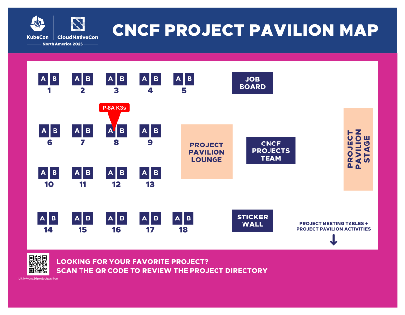

# Project K3s at KubeCon + CloudNativeCon North America 2026 in Salt Lake City

The cloud-native community is heading back to Salt Lake City, Utah for **KubeCon + CloudNativeCon North America 2026**, running **November 9–12, 2026** at the Salt Palace Convention Center. With 9,000+ expected attendees from 2,100+ organizations and 400+ sessions spanning Kubernetes, security, AI infrastructure, and platform engineering — this is the biggest gathering of cloud-native practitioners of the year.

**Project K3s** will be there. If you care about lightweight Kubernetes, edge computing, IoT deployments, or simply want to meet the people building K3s, this is your event.

<!-- truncate -->

# K3s's Presence at KubeCon NA 2026

## Lightning Talk

K3s will be kicking off the week with a **Project Lightning Talk** — five minutes, high signal, covering the latest progress and what's on the roadmap.

**[Project Lightning Talk – K3s](https://kubecon-cloudnativecon-north-america-2026.sessionize.com/session/1289886)**  
📅 Monday, November 9, 2026  
🎤 Speaker: Orlin Vasilev, K3s Community Manager, SAP

Expect a concise overview of how K3s continues to evolve and support modern cloud-native workloads at the edge and beyond.

## Project Pavilion Kiosk

The **[Project Pavilion](https://events.linuxfoundation.org/kubecon-cloudnativecon-north-america/features-add-ons/project-engagement/#project-pavilion)** is where CNCF projects set up kiosks for the duration of the conference. The K3s kiosk is your chance to meet maintainers face to face, see demos, and get answers to the questions you've been saving up.

Find K3s at booth **P-8A** in the Project Pavilion:

**Tuesday:** 10:30 AM – 2:30 PM

Come to the kiosk to:

- Meet contributors and maintainers
- Discover integrations and real-world use cases
- Ask questions about running K3s in production
- Explore ways to get involved

## Come Find Us

You'll find K3s maintainers and community members at KubeCon NA 2026 at the lightning talk and at the kiosk. Come say hello, challenge us with hard questions about K3s's roadmap, or just tell us how you're using it in production.

We genuinely want to hear what's working, what's not, and what you wish K3s could do.

## Why K3s in 2026

The broader theme at KubeCon NA 2026 is production AI infrastructure — GPU scheduling, model deployment, agentic workloads, security, and cost management at scale. K3s sits at the intersection of all of it: if you need Kubernetes running close to the data source — in a factory, on a ship, at the network edge, or on a satellite — K3s is how you do it without paying the full Kubernetes tax.

Key areas K3s addresses:

- **Lightweight footprint** — single binary under 100MB, minimal RAM requirements, perfect for constrained hardware
- **Edge and IoT** — purpose-built for environments where full Kubernetes would be too heavy or complex
- **Air-gapped deployments** — built-in support for disconnected environments with bundled images
- **Simplified operations** — embedded etcd, embedded load balancer, auto-deploying manifests, built-in Helm controller
- **CNCF-certified Kubernetes** — full conformance, so your existing tooling and workloads just work

If any of that maps to a problem you're solving, find us in Salt Lake City.

## Join the K3s Community

KubeCon is not just a conference — it's where the people building K3s and the people running it in production meet face to face. Whether you're a first-time attendee curious about the project, an existing operator with sharp feedback, or a potential contributor ready to dive in — the K3s community welcomes you.

K3s has grown into one of the most impactful Kubernetes distributions thanks to its vibrant and welcoming community. Whether you're running clusters at the edge, in the cloud, or somewhere entirely unexpected — there's a place for you in the K3s ecosystem.

**See you in Salt Lake City, November 9–12, 2026!**

[*For more details and to register for KubeCon + CloudNativeCon North America 2026, visit the official event page.*](https://events.linuxfoundation.org/kubecon-cloudnativecon-north-america/register/)

 

[Orlin Vasilev](https://www.linkedin.com/in/orlinvasilev/)  
K3s Community Manager
